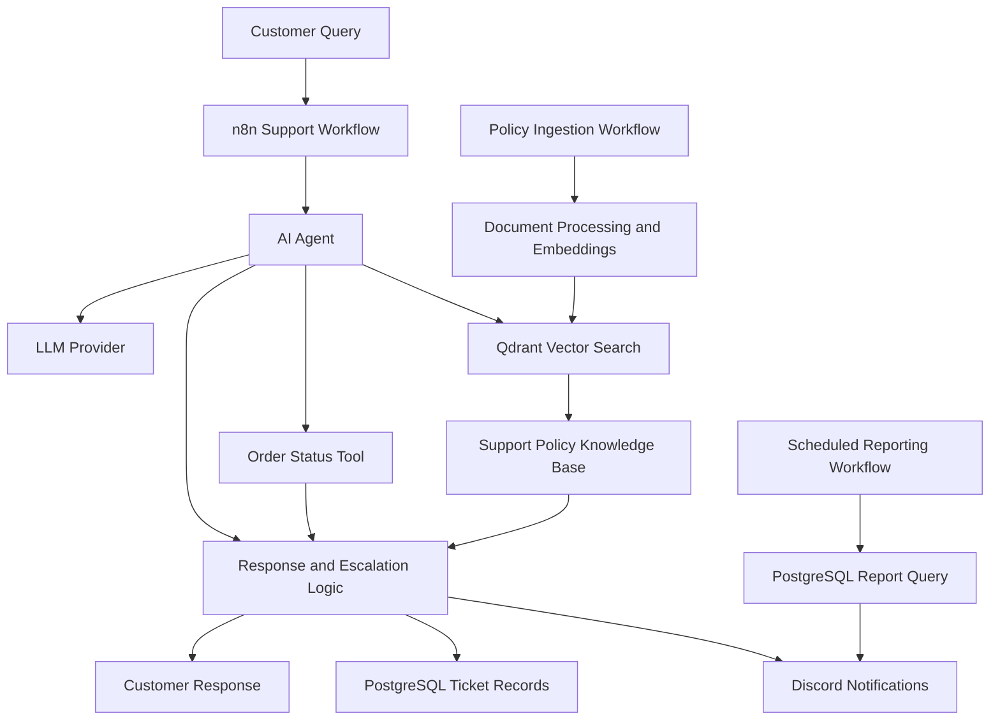

# 🛍️ ShopEasy — AI-Powered Customer Support System

<p align="center">
  <strong>Intelligent Customer Support Automation with AI Agents, RAG & Workflow Orchestration</strong>
</p>

<p align="center">
  
  
  
  
  
</p>

<p align="center">
  An AI-driven support automation project that combines LLM-powered conversations, retrieval-augmented generation (RAG), database tools, and workflow automation to streamline customer support operations.
</p>

---

## 📌 Table of Contents

- [Overview](#-overview)
- [Key Features](#-key-features)
- [System Architecture](#-system-architecture)
- [Technology Stack](#-technology-stack)
- [Workflow Components](#-workflow-components)
- [Project Structure](#-project-structure)
- [Getting Started](#-getting-started)
- [Configuration](#-configuration)
- [Testing and Evaluation](#-testing-and-evaluation)
- [Security](#-security-considerations)
- [Current Limitations](#-current-limitations)
- [Roadmap](#-roadmap)
- [Contributing](#-contributing)
- [License](#-license)

## 🚀 Overview

**ShopEasy AI Support System** is a workflow-driven customer support solution designed to automate repetitive support tasks and help support teams respond to customer questions more efficiently.

The system combines an AI agent with external tools and a searchable policy knowledge base. It is designed to retrieve relevant support information, look up order status, handle escalation workflows, store ticket information, and send notifications to a support team.

Rather than relying entirely on an LLM's general knowledge, the system uses retrieval and tool integrations to provide a more structured approach to support requests.

### 🎯 Project Goals

- Automate repetitive customer support workflows.
- Retrieve relevant information from a support-policy knowledge base.
- Connect AI responses to external tools and structured data.
- Provide escalation and ticket-recording mechanisms.
- Improve visibility through support notifications and reporting.
- Establish a foundation for secure, maintainable AI support automation.

## ✨ Key Features

| Feature | Description |
|---|---|
| 🤖 AI Support Agent | Processes incoming customer questions using an LLM-powered workflow. |
| 📦 Order Status Lookup | Provides a workflow tool for retrieving order-related information. |
| 📚 Policy Knowledge Base | Uses Qdrant vector search to retrieve relevant support-policy content. |
| 🔎 Retrieval-Augmented Generation | Supplies retrieved context to the AI workflow for grounded answers. |
| 🎫 Ticket Management | Includes PostgreSQL workflow components for recording escalations and tickets. |
| 🔔 Discord Notifications | Sends configured support notifications to a Discord channel. |
| 📊 Daily Reporting | Includes a workflow intended to generate scheduled support reports. |
| 📥 Policy Ingestion | Provides a separate workflow for preparing policy content and storing embeddings. |
| 🐳 Containerized Setup | Uses Docker Compose to simplify local service management. |
| 🛡️ Safety-Oriented Design | Includes evaluation scenarios for prompt injection, fallback behavior, and escalation. |

*Feature availability depends on workflow configuration, credentials, and successful integration testing.*

## 🏗️ System Architecture



### 🔄 High-Level Request Lifecycle

1. **Receive:** The n8n workflow receives a customer query.
2. **Interpret:** The AI agent processes the request using the configured LLM.
3. **Retrieve:** Relevant policy information can be retrieved from Qdrant.
4. **Use tools:** The workflow can invoke configured tools, such as order-status lookup.
5. **Respond or escalate:** The workflow processes the response or routes the case toward escalation.
6. **Record and notify:** Configured workflow nodes can record ticket information and notify the support team.

The diagram describes the intended architecture. Actual execution paths should be verified against the imported n8n workflows.

## 🧰 Technology Stack

| Technology | Role |
|---|---|
| **n8n** | Visual workflow orchestration and integrations |
| **LLM API** | Natural-language understanding and response generation |
| **Google Gemini Embeddings** | Converts policy text into vector representations |
| **Qdrant** | Vector database for semantic retrieval |
| **PostgreSQL** | Structured ticket storage and reporting queries |
| **Discord Webhooks / Integration** | Support alerts and team notifications |
| **Docker Compose** | Local container orchestration |
| **Git & GitHub** | Version control and project documentation |

## ⚙️ Workflow Components

### 1. Customer Support Workflow

**File:** `n8n/workflows/support-agent-v2 (1).json`

The primary workflow contains components for:

- Receiving chat messages
- Processing customer requests through an AI agent
- Connecting the LLM to support tools
- Retrieving policy information through Qdrant
- Handling order-status lookups
- Recording ticket-related data in PostgreSQL
- Sending configured Discord notifications

### 2. Policy Ingestion Workflow

**File:** `n8n/workflows/Ingest Policies.json`

Designed to prepare support-policy content for retrieval.

Expected processing stages:

1. Load or prepare policy content.
2. Process text into documents or chunks.
3. Generate embeddings.
4. Store vectors in Qdrant.
5. Make the indexed content available for retrieval.

Verify the input content, collection configuration, and ingestion results before testing the support agent.

### 3. Daily Reporting Workflow

**File:** `n8n/workflows/Daily Report (1).json`

Contains components for:

- Scheduled or manual execution
- Querying reporting data from PostgreSQL
- Preparing report fields
- Sending report information through Discord

The schedule, SQL query, and notification path must be verified in n8n before relying on automated daily reports.

## 📁 Project Structure

```text
ai-support-system/
├── docker-compose.yml
├── README.md
├── eval/
│   └── test_questions.md
└── n8n/
    └── workflows/
        ├── support-agent-v2 (1).json
        ├── Ingest Policies.json
        └── Daily Report (1).json
```

## 🚀 Getting Started

### Prerequisites

Make sure you have:

- [Docker Desktop](https://www.docker.com/products/docker-desktop/)
- Docker Compose
- Access to the configured n8n instance
- An API key for the selected LLM provider
- Google Gemini credentials for embeddings, if used
- Qdrant access
- PostgreSQL credentials
- A Discord webhook or configured Discord integration

### 1️⃣ Clone the Repository

```bash
git clone https://github.com/YOUR_USERNAME/shopeasy-ai-support-system.git
cd shopeasy-ai-support-system
```

Replace `YOUR_USERNAME` and the repository name with your actual GitHub details.

### 2️⃣ Review Docker Configuration

Inspect `docker-compose.yml` before starting services.

Check the configured:

- Service names and ports
- Environment variables
- Persistent volumes
- Database credentials
- n8n access settings
- Qdrant and PostgreSQL connectivity

### 3️⃣ Configure Environment Variables

Create a local `.env` file only for variables referenced by your Compose configuration.

Example placeholders:

```env
POSTGRES_USER=your_database_user
POSTGRES_PASSWORD=replace_with_a_secure_password
POSTGRES_DB=your_database_name
```

This is an illustrative example, not a complete configuration. Match the variable names to your actual `docker-compose.yml`.

Never commit real credentials or API keys.

### 4️⃣ Start the Services

```bash
docker compose up -d
```

Check service status:

```bash
docker compose ps
```

Inspect logs:

```bash
docker compose logs
```

### 5️⃣ Import the n8n Workflows

1. Open your configured n8n instance.
2. Import the workflow JSON files from `n8n/workflows/`.
3. Configure the required credentials in the relevant nodes.
4. Verify the database schema and vector-store collection.
5. Run the policy-ingestion workflow with valid sample data.
6. Test the support workflow with representative customer questions.
7. Verify notification, ticketing, fallback, and scheduling behavior.
8. Activate workflows only after checking their execution paths.

> **Important:** Workflow imports do not automatically configure credentials, create every required database table, or guarantee that integrations will work.

## 🧪 Testing and Evaluation

Test scenarios are documented in `eval/test_questions.md`.

Recommended validation areas:

| Test Area | What to Verify |
|---|---|
| Policy questions | Answers are consistent with the retrieved policy content. |
| Retrieval quality | Relevant chunks are retrieved for representative questions. |
| Order lookup | Valid and invalid order requests are handled correctly. |
| Unknown questions | The system avoids inventing unsupported policy details. |
| Escalation | Cases requiring human attention follow the intended route. |
| Ticketing | Tickets are recorded accurately in PostgreSQL. |
| Notifications | Discord alerts contain the correct message and context. |
| Prompt injection | Untrusted instructions do not override system safeguards. |
| Failure handling | Missing credentials or unavailable services produce controlled failures. |
| Scheduled reports | Reports run at the configured time without duplicate notifications. |

Record actual test results before publishing performance claims. Do not describe the system as production-ready until its critical paths have been tested end-to-end.

## 🔐 Security Considerations

Security is essential for any customer-facing AI system.

- 🔑 Store API keys and passwords in environment variables or a secrets manager.
- 🚫 Exclude `.env` files and credentials from Git.
- 🔒 Protect the n8n editor and restrict workflow access.
- 🛡️ Authenticate incoming webhooks where applicable.
- 🗄️ Use least-privilege database accounts.
- 🧹 Avoid logging unnecessary customer information.
- 🔍 Test prompt-injection and tool-input validation.
- 👤 Verify human approval and escalation behavior before enabling sensitive actions.
- 📣 Avoid exposing private customer data in public Discord channels.

## ⚠️ Current Limitations

This repository represents a development project, and configuration-dependent behavior requires verification.

Before production use, confirm:

- End-to-end support workflow execution
- Correct human approval and rejection behavior
- Scheduled daily report execution
- Database persistence and schema setup
- Qdrant collection and embedding compatibility
- Authentication, authorization, and secret management
- Logging, monitoring, and recovery from failed integrations

A workflow file being present in the repository does not, by itself, prove that the workflow is fully functional.

## 🗺️ Roadmap

- [ ] Verify end-to-end support workflow execution
- [ ] Complete and test human approval and rejection
- [ ] Validate daily report scheduling and notification behavior
- [ ] Add automated evaluation and regression tests
- [ ] Improve error handling and observability
- [ ] Strengthen webhook authentication and access controls
- [ ] Add deployment and troubleshooting documentation
- [ ] Prepare a sanitized demo with sample customer data

## 🤝 Contributing

Contributions, bug reports, and suggestions are welcome.

1. Fork the repository.
2. Create a feature branch.
3. Make your changes.
4. Test the affected workflows.
5. Open a pull request with a clear description.

## 📄 License

No license has been specified yet. Add a `LICENSE` file before granting others permission to reuse, modify, or distribute this project.

---

<p align="center">
  <strong>Built to explore practical AI agents, RAG pipelines, and customer-support automation.</strong>
</p>
